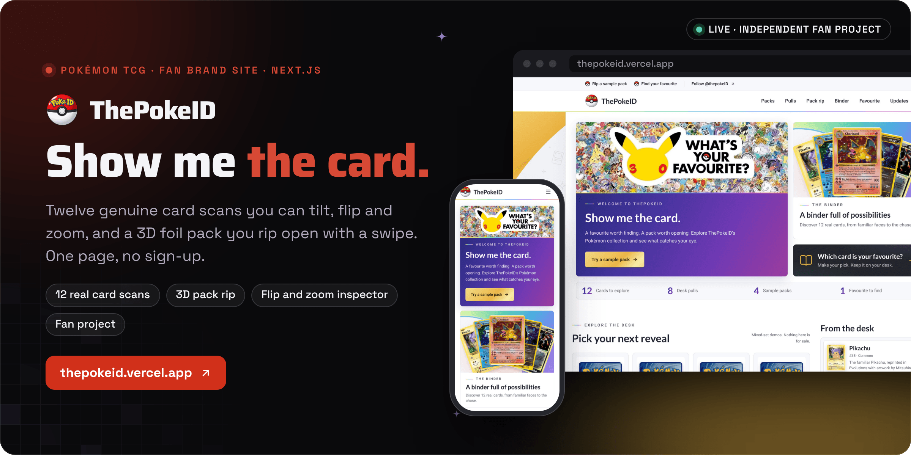

<div align="center">



<br><br>

<a href="https://thepokeid.vercel.app"></a>&nbsp;&nbsp;
<a href="https://thepokeid.vercel.app/#rip"></a>&nbsp;&nbsp;
<a href="https://x.com/thepokeID"></a>

<br><br>

<a href="https://thepokeid.vercel.app"></a>


<h3>A favourite worth finding. A pack worth opening.</h3>

<b>Pick a pack</b> &nbsp;→&nbsp; <b>Tear it open</b> &nbsp;→&nbsp; <b>Flip the hit</b> &nbsp;→&nbsp; <b>Inspect the card</b> &nbsp;→&nbsp; <b>Keep a favourite</b>

<br>

<a href="#how-it-works">How it works</a> &nbsp;·&nbsp;
<a href="#status">Status</a> &nbsp;·&nbsp;
<a href="#run-it-locally">Run it locally</a> &nbsp;·&nbsp;
<a href="#cards-and-credits">Cards and credits</a>

</div>

<br>

<picture>
  <source media="(prefers-color-scheme: dark)" srcset="docs/readme/screens-dark.png">
  
</picture>

<p align="center"><sub>Captured from the live site, thepokeid.vercel.app, on 11 November 2026 at 1440 by 900.</sub></p>

**ThePokeID is a one-page brand site for [ThePokeID](https://x.com/thepokeID), built around real Pokémon cards.** Twelve genuine card scans lean toward your pointer, open in an inspector you can flip and zoom, and come out of a 3D foil pack you tear open with a swipe. It is a showcase, not a shop: the packs, pulls, drops and waitlist are demonstrations, and nothing you do leaves your browser.

Built by Matt ([RVAClassic](https://x.com/rvaclassic), [Operator Uplift](https://operatoruplift.com)) in November 2026. It is an independent fan project, not affiliated with, endorsed by or sponsored by Nintendo, The Pokémon Company, Creatures Inc. or GAME FREAK.

<br>

## How it works

<picture>
  <source media="(prefers-color-scheme: dark)" srcset="docs/readme/flow-dark.png">
  
</picture>

<table>
  <tr valign="top">
    <td width="33%"><b>Real cards, served locally</b><br><sub>Twelve genuine Pokémon TCG fronts from the Pokémon TCG API's high-resolution scans, plus a printed card back. Source URLs and checksums sit in <code>public/cards/sources.json</code>, and nothing loads from an image CDN at runtime.</sub></td>
    <td width="33%"><b>Cards that react</b><br><sub>Each card turns up to 18 degrees toward the pointer on a spring, lifts off the page and casts a deeper shadow, with glare and foil following the light. On a touch screen, press and hold to tilt a card toward your finger.</sub></td>
    <td width="33%"><b>A pack you tear</b><br><sub>A heat-sealed foil pack generated in three.js. Swipe the top strip to tear it to a synthesized crackle, then turn the five cards over. The fifth is the hit: it waits face down in a gold glow until you flip it.</sub></td>
  </tr>
  <tr valign="top">
    <td width="33%"><b>Light where it counts</b><br><sub>three.js and the stage, about 150 KB gzipped, load only as the section nears the screen. The stage stops drawing off screen and draws fewer pixels on devices that cannot keep up.</sub></td>
    <td width="33%"><b>Accessible by default</b><br><sub>The inspector works from the keyboard, the drops strip stops under focus and has a pause button, reduced motion keeps gentle versions of every effect, and section colors keep at least 4.5:1 contrast on white.</sub></td>
    <td width="33%"><b>Honest demos</b><br><sub>The pack does not represent official collation or pull rates. Chase highlights are editorial picks, separate from official rarity, and the waitlist keeps an email in your browser only.</sub></td>
  </tr>
</table>

<p align="center"><sub>Next.js 16 · React 19 · TypeScript · Tailwind CSS 4 · three.js · Motion · Web Audio · next/og</sub></p>

<br>

## Status

| Status | Part | Notes |
|---|---|---|
|  | [thepokeid.vercel.app](https://thepokeid.vercel.app) | The one-page site on Vercel, with Open Graph and Twitter share images rendered from the real card scans. |
|  | Packs, pulls, drops and waitlist | Demonstrations. Nothing is inventory or an offer to sell, and the waitlist stores an email in `localStorage` only. |

<br>

## Run it locally

<table>
  <tr valign="top">
    <td width="33%"><b>Prerequisites</b><br><sub>Node.js 24 for development and the regression tests (Next.js itself needs 20.9 or newer) and npm. No environment variables are required.</sub></td>
    <td width="33%"><b>Read first</b><br><sub><a href="AGENTS.md"><code>AGENTS.md</code></a>: this Next.js version differs from older documentation, so read the guide in <code>node_modules/next/dist/docs/</code> before changing framework code.</sub></td>
    <td width="33%"><b>What the checks prove</b><br><sub><code>npm run lint</code> is clean, <code>npm test</code> runs 35 regression tests on Node's test runner (card tilt, the 3D pack shape and tweens, sample packs, the story loop and browser storage), and <code>npm run build</code> prerenders the page.</sub></td>
  </tr>
</table>

1. Install and start the dev server.

   ```bash
   npm ci                        # install the exact dependency tree
   npm run dev                   # http://localhost:3000
   npm run dev -- --port 4327    # optional: the origin the default local metadata uses
   ```

2. Run the checks, then serve a production build.

   ```bash
   npm run lint                  # ESLint
   npm test                      # node --test, needs Node.js 24
   npm run build                 # production build
   npm start                     # serve the build
   ```

| Variable | Required | What it does |
|---|---|---|
| `NEXT_PUBLIC_SITE_URL` | No | The production origin (for example `https://thepokeid.com`) used for canonical URLs, the sitemap and JSON-LD. On Vercel, `VERCEL_URL` is used when it is unset. |

To deploy, import the repo into Vercel with the Next.js framework preset. No environment variables are required.

<details>
<summary><b>The card collection</b></summary>
<br>

Twelve genuine Pokémon TCG fronts and a printed card-back scan are bundled in `public/cards`. The fronts are the Pokémon TCG API's high-resolution scans (600×825 for vintage cards, 733 to 734 by 1024 for modern ones), so cards stay sharp at binder size on high-density screens. Names, HP, set numbers, rarities and illustrators are matched to the public Pokémon TCG dataset; the Exeggcute illustrator was read from the scan where the dataset omitted it. Source URLs and checksums are recorded in `public/cards/sources.json`. No runtime connection to an image CDN is required.

</details>

<details>
<summary><b>Cards and the inspector</b></summary>
<br>

Cards react to the pointer in 3D. Each card turns to face the cursor, up to 18° toward any edge, leans after it, and lifts off the page with a small pop. Its shadow falls further as it rises, and directional shading, glare and foil follow the light. The motion runs on a spring (`src/lib/card-tilt.ts`): cards overshoot slightly and wobble back to rest when the pointer leaves, and pressing pushes a card back down. Perspective scales with each card's size, so desk thumbnails tilt as visibly as the inspector scan, and cards wider than 240px travel no further in pixels than a 240px card. The artwork moves inside a stationary hit area so its motion does not feed back into pointer coordinates; resting cards drop their transforms. The graded slab tilts as one piece with its card seated inside, and keyboard focus presents a card in a three-quarter pose. On touchscreens, swipes and quick taps leave cards still; press and hold to tilt a card toward your finger. Reduced motion keeps a gentle 5° tilt without travel, pop or bounce.

Cards open a keyboard-accessible inspector. Tap or press the flip control to see the back, and zoom to inspect the original scan; the zoomed scan holds still and can be panned on mobile. The selected favourite and featured desk card also open the inspector.

All card areas use the shared `CardSurface` hover treatment, including the hero fan, feed thumbnails, favourite picker, story cards and card backs. The four selection tiles and the face-down cards use the original blue Pokémon card back.

</details>

<details>
<summary><b>The pack theater</b></summary>
<br>

The sample pack is a sealed foil pack with ThePokeID's own artwork rather than an official pack design, opened in a dark theater. Where WebGL 2 is available it is a real 3D object built with three.js. The pack is generated in code as a heat-sealed pillow with crimped, saw-toothed ends (`src/lib/pack3d/shape.ts`), and its printed foil, gloss and metal map, crease normals and lettering are painted onto canvases when it loads (`src/lib/pack3d/art.ts`). The foil is an iridescent physical material reflecting a soft night-sky environment, with bloom on the brightest light. The pack floats among stars and leans toward the pointer.

Swipe across the pack and the top strip tears along its perforation: the free foil curls up off the pack without stretching, light leaks through the widening gap, and a synthesized foil crackle follows the speed of the swipe (phones that can vibrate tick as it tears). Letting go past 60%, or flicking, finishes the tear; letting go earlier leaves the strip half torn until the next swipe. Pressing the pack or the button rips it after a short shake. The strip pops off and flies away, light and sparks burst from the opening, the five cards rise, and the pack drops away. Each card then turns over in 3D and leans toward the pointer, and a rainbow sheen slides across holo cards as they turn; tap or throw the card, or use the arrow keys, for the next. The fifth card is the hit: it waits face down in a gold glow until it is flipped on purpose, then lands with a flash, rays, a shimmer and a gold plate. "Show all five" skips to the spread, where any card opens the inspector. Choosing a tile loads that named pack and rips it once the page has scrolled to it. The sounds are made with Web Audio, play only after the pack has been touched, and can be muted; the setting is remembered in `localStorage`.

three.js and the stage (about 150 KB gzipped) load only as the section nears the screen. The stage stops drawing while the section is off screen, and draws fewer pixels on devices that cannot keep up. Until it is ready, and wherever WebGL 2 is missing or lost, a 2D pack runs the same rip in CSS: drag across it to tear the strip, where letting go past halfway finishes the rip and letting go earlier springs it back, then swipe through the cards. Reduced motion keeps the 2D pack, skips the rip and shows the spread.

The theater takes its cues from [addict.munden.org](https://addict.munden.org/) and [blockrips.com](https://blockrips.com/), and the shake and one-at-a-time reveal follow [hongyime/pokemonpacks](https://github.com/hongyime/pokemonpacks) (Apache-2.0); no code was copied from any of them.

</details>

<details>
<summary><b>Drops, favourites and storage</b></summary>
<br>

The drops are three stories on an endless strip that drifts slowly to the left, with no scrollbar. Each story wraps from one end to the other by itself, so there are no hidden copies for keyboards or screen readers. The strip stops under the mouse or keyboard focus, can be dragged and flung either way, and has a pause button; reduced motion starts it paused.

Pulls, the mixed-set demo pack, drops and the waitlist are demonstrations. Chase highlights are editorial selections, separate from official rarity. The pack does not represent official collation or pull rates. The waitlist stores an email in `localStorage` only; nothing is sent to a server.

Favourites and preview-list entries sync across tabs on the same origin. When browser storage is blocked or full, the site displays an error instead of claiming the entry was saved.

</details>

<details>
<summary><b>Header, finish and brand assets</b></summary>
<br>

The header follows Pokémon.com's current layout: a utility row of small links that scrolls away, then a pinned bar with the logo and text links. Hovering or focusing a link, or scrolling to its section, colors the label and raises a Poké Ball of the same color from the bar's bottom edge, so its top half shows, centered under the label. The ball springs up and sinks back when the pointer leaves. Section colors keep at least 4.5:1 contrast on white. The utility links use the 475ms downward bounce (6px at 40%, 1px at 60%) from Pokémon.com's published [gus.css](https://assets.pokemon.com/static2/_ui/css/gus.css). Hover effects run when any input supports hover. On phones the bar keeps the logo and an accessible drawer, where each section shows its colored Poké Ball.

The finish takes after the Pokémon TCG 30th Celebration premium collection boxes, using ThePokeID's own motifs rather than their logos or artwork. Pearl surfaces sit over an original line-art pattern of Poké Balls, cards and sparkles, framed by gold corners. Two holo finishes, aurora (lime to violet) and eclipse (indigo to gold), are cut by pearl lid circles with rainbow rims. A rainbow foil edge runs under the header and along the dark bands. Section labels use spaced capitals with a foil rule, primary buttons and plates are gold foil, and charcoal bands with silver type carry the slab, the list and the footer. Text on holo grounds only sits over stops that keep 4.5:1 contrast. Reduced motion keeps the Poké Ball and the finishes but drops the springs and sheens. Bundled Lato and Roboto set the type.

`public/brand` holds the supplied logo, avatar and X banner. The logo background was removed so it can sit on the page.

Web fonts are bundled in `src/fonts` with their licenses and provenance. Builds do not download Google Fonts or card artwork. Card scans are served locally, with original files in the inspector. Every other card declares the width it is drawn at, so the browser fetches a thumbnail at least that sharp for the screen's pixel density, encoded at quality 85 to keep fine print and foil texture.

</details>

<details>
<summary><b>Share previews</b></summary>
<br>

Open Graph and Twitter images are rendered with `next/og` at 1200×630 using the supplied logo and authentic card scans. Both routes use the versioned metadata ID `real-cards-v2`; bump that ID when changing the design to give social crawlers a fresh image URL. The shared composition is in `src/lib/social-image.tsx`.

</details>

<details>
<summary><b>Repository layout</b></summary>
<br>

| Path | Contents |
|---|---|
| `src/app/` | The page, layout, metadata routes (sitemap, robots, manifest, icons) and the Open Graph and Twitter image routes |
| `src/components/` | Header, hero, packs, pulls, the pack rip, binder, slab, favourite picker, drops, waitlist and footer |
| `src/lib/` | Card tilt spring, story loop, sample packs, browser storage, social image and `pack3d/` (pack shape, art and tweens) |
| `src/data/` | The card list and desk content |
| `src/fonts/` | Bundled web fonts with their licenses |
| `public/cards/` | The twelve card scans, the card back and `sources.json` |
| `public/brand/` | The supplied logo, avatar and X banner |
| `tests/` | Node test runner suites |

</details>

<br>

## Cards and credits

The twelve card fronts are the Pokémon TCG API's high-resolution scans, retrieved on 6 November 2026, and the back is a printed card-back scan; the source of every file and its SHA-256 are in `public/cards/sources.json`. Names and set details are matched to the public [pokemon-tcg-data](https://github.com/PokemonTCG/pokemon-tcg-data) dataset. Pokémon, the card artwork and related marks belong to Nintendo, The Pokémon Company, Creatures Inc. and GAME FREAK. The sample pack, the line-art pattern and the finishes are ThePokeID's own designs, and the bundled fonts keep the licenses stored beside them in `src/fonts`.

<br>

<p align="center"><sub>This repository has no license file yet. ThePokeID is an independent fan project and is not affiliated with, endorsed by or sponsored by Nintendo, The Pokémon Company, Creatures Inc. or GAME FREAK.</sub></p>

<p align="center"><sub>Built by <a href="https://rvaclassic.xyz">Matt Sim</a>, founder of <a href="https://operatoruplift.com">Operator Uplift</a>. More builds at <a href="https://github.com/operatoruplift">github.com/operatoruplift</a>. Want one built for your product? <a href="https://cal.com/rvaclassic/15min">Book a 15-minute call</a>.</sub></p>
